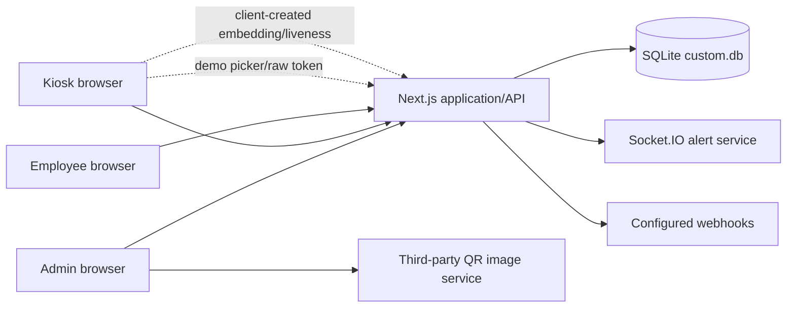
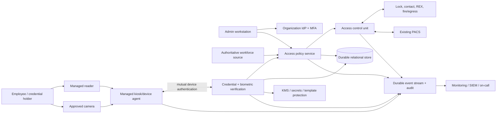
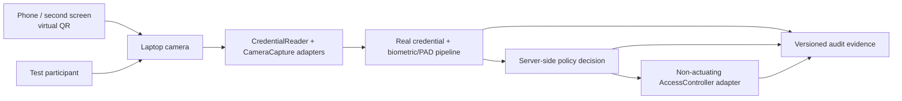

# System context and data flow

Status: accepted architecture baseline for non-actuating development

## Current implementation

Current critical trust problems:

- the browser participates in security decisions that must be independently verified;
- kiosk verification, configuration, and synchronization routes lack managed-device identity;
- face probes, liveness values, and override PIN decisions originate in client code;
- raw card tokens are sent to an external QR service for image generation;
- application memory holds sessions and pending transactions;
- SQLite, local JSON, and the in-memory alert service form the durability boundary;
- there is no card reader, access-control unit, or observed door-state integration.

## Proposed production context

This diagram is a target boundary, not a selected vendor architecture.

## Initial reference implementation

The first implementation exercises the target boundaries without pretending that a laptop is production hardware.

Credential scanning and face capture use the camera sequentially. The adapters and audit contract remain stable when the laptop components are later replaced with managed readers, approved cameras, cloud/on-premises verification, and an access-control unit.

## Trust boundaries

| Boundary | Untrusted/less trusted side | Trusted side | Required control |
|---|---|---|---|
| Person to reader/camera | Presented card, face, artifact, attacker | Managed sensor/reader | Credential authenticity, PAD, retry limits, tamper detection |
| Peripheral to kiosk agent | USB/NFC/camera/reader data | Managed device agent | Approved driver/firmware, device allowlist, signed update, health evidence |
| Kiosk to services | Site network and kiosk process | Verification/policy services | Unique device certificate, mutual authentication, authorization, freshness, rate limits |
| Browser to APIs | Browser/user-controlled values | Application/API | IdP session, schema validation, CSRF/origin protection, server-side authorization |
| Verification to storage/keys | Application workload | DB/KMS/template vault | Workload identity, least privilege, envelope encryption, audit |
| Policy to controller | Network and wiring | ACU/door | Authenticated supervised protocol, command/result correlation, fail-mode design |
| Services to integrations | Configured URLs/vendor systems | Alert/webhook boundary | Egress allowlist, SSRF controls, signed delivery, redaction, durable retries |
| Admin to production | Human/operator endpoint | Control plane | MFA, least privilege, approval, session/device posture, attributable audit |

## Data inventory

| Data class | Current location/use | Production rule to approve |
|---|---|---|
| Employee identity and department | `Employee`, `Department` in SQLite | Authoritative source, allowed fields, correction, retention, tenant isolation |
| Face template | JSON vector in `Employee.faceEmbedding` | Separate encryption/protection, model version, access restrictions, deletion verification |
| Enrollment/consent | `Enrollment` plus timestamps/boolean | Notice/consent version, operator/device/evidence, lawful basis, withdrawal handling |
| Raw face frames | Previewed; no real pipeline; snapshot path is not real evidence | Default no retention; tightly bounded exception and deletion if approved |
| Credential token/hash | Token handled by UI; hash stored on employee/revocation | No third-party disclosure; lifecycle, anti-replay, key/version and revocation rules |
| Access event | `ScanEvent` | Minimized stable subject reference, factor/policy versions, hardware result, tamper evidence |
| Administrator event | `AdminAction` | Transactional/durable write, before/after minimization, actor/session context |
| Kiosk config/health | `Kiosk` and API responses | Device-authorized signed version, expiry, health/tamper/firmware context |
| Sessions | Process memory and browser persistence | Secure durable revocation, short-lived tokens/cookies, no localStorage bearer tokens |
| Webhook secret/config | Local JSON | KMS-backed secret, write-only display, allowlisted destination and audit |

## Primary production data flow

1. Workforce identity is imported or synchronized from an approved source.
2. An authenticated operator verifies the person and issues a credential.
3. If face verification is approved, the person receives notice and uses the controlled enrollment station; approved frames are converted to a protected template.
4. At presentation, the managed reader and camera send evidence through the device agent with transaction freshness and device identity.
5. Verification validates credential, revocation, PAD, face match, retries, and evidence integrity.
6. Policy evaluates identity state, schedule/zone, kiosk/door state, lockdown, offline state, and override state.
7. The controller receives an authenticated command and returns acknowledgement/door state.
8. Durable events correlate presentation, verification, policy, command, and physical result; alerts are derived without exposing sensitive evidence.

## Data lifecycle decisions required

For every data class specify purpose, lawful basis/authority, fields, source, recipients, region, encryption key, access roles, online retention, backup retention, deletion SLA, legal hold, export/correction mechanism, and incident classification. Phase 0 cannot complete with “indefinite” as a default retention period.
